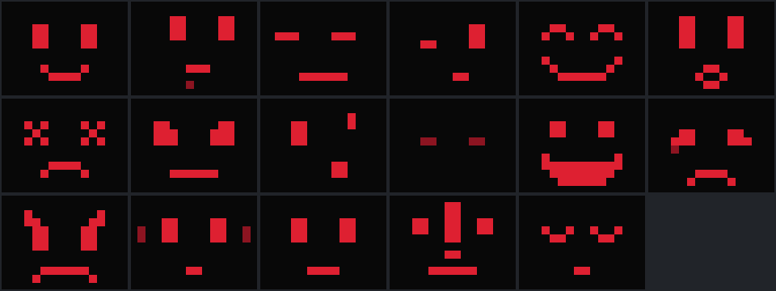

# Rosto do d-BMO

O rosto é a tela ociosa do aparelho: blocos de pixel vermelho sobre fundo escuro, numa
grade fixa de 16 × 12 (20 px por bloco na ILI9341 de 320 × 240).



Folha gerada por `dbmo_face_preview --ppm` (primeiro quadro de cada expressão, na ordem
da tabela). É saída do código deste diretório, não arte conceitual.

## O que há aqui

| Arquivo | Papel |
|---|---|
| `rosto_faces.h` | Tabela única dos desenhos, em texto (`#`, `+`, `.`). Usada pelo sketch e pela biblioteca |
| `rosto.ino` | Sketch de bancada (Arduino IDE): troca de estado pelo botão OK e pela serial |
| `teste/teste_faces.cpp` | Conferência rápida da tabela, sem dependências |
| `include/dbmo/rosto/`, `engine/` | Biblioteca do firmware próprio (`dbmo_rosto`) |
| `tools/face_preview.cpp` | Pré-visualização no computador (texto e folha PPM) |

As fontes da biblioteca ficam em `engine/`, e não em `src/`, porque esta pasta também é
um sketch e o Arduino IDE compila tudo o que estiver em `src/`.

## Expressões

Dezessete estados. Os dez primeiros são os da especificação do personagem
(`resende-g/d-BMO`, `docs/brand/CHARACTER_SPECIFICATION.md`, versão 2.0) e foram mantidos
pixel a pixel; um teste compara o CRC-32 de cada um com o da versão original.

| # | Nome | Origem | Tipo padrão |
|---:|---|---|---|
| 0 | `IDLE` | especificação | base |
| 1 | `THINKING` | especificação | base |
| 2 | `SCANNING` | especificação | base |
| 3 | `ANALYZING` | especificação | base |
| 4 | `SUCCESS` | especificação | transitória, 1,5 s |
| 5 | `ALERT` | especificação | transitória, 3 s |
| 6 | `ERROR` | especificação | transitória, 4 s |
| 7 | `PROTECTING` | especificação | base |
| 8 | `CURIOUS` | especificação | transitória, 2 s |
| 9 | `OFFLINE` | especificação | base |
| 10 | `HAPPY` | firmware | transitória, 2 s |
| 11 | `SAD` | firmware | transitória, 2 s |
| 12 | `ANGRY` | firmware | transitória, 2 s |
| 13 | `LISTENING` | firmware | base |
| 14 | `SPEAKING` | firmware | base |
| 15 | `WARNING` | firmware | transitória, 3 s |
| 16 | `SLEEP` | firmware | base |

**Pendência de identidade:** os sete estados de origem "firmware" não constam da
especificação do personagem nem dos design tokens. Eles seguem a mesma grade e as mesmas
duas cores, mas precisam ser aprovados e incorporados lá (ou removidos daqui). Um teste
garante que quaisquer duas expressões diferem na forma, e não só na cor, como pedem os
design tokens ("não depender apenas da cor para comunicar estado").

## Biblioteca

Três peças independentes:

- **`FaceEngine`** (`face_engine.h`): máquina de estados. Uma expressão de base e,
  opcionalmente, uma transitória por cima, que dura um tempo e devolve o lugar à base.
  Prioridades impedem que `ERROR`, `WARNING` e `ALERT` sejam cobertas por pedidos menos
  importantes. Duração, prioridade e repetição de cada expressão são configuráveis
  (`setPolicy`). Não bloqueia: anda por `tick(nowMs)` e resiste ao estouro do relógio.
  Não há humor autônomo: o rosto só muda por pedido.
- **`FaceRenderer`** (`face_renderer.h`): desenha um quadro num `dbmo::display::IDisplay`,
  redesenhando só os blocos que mudaram. O bloco é o maior inteiro que cabe na tela.
- **`FaceSubsystem`** (`face_subsystem.h`): liga os dois ao `EventBus`.

### Eventos (domínio `Face`)

| Evento | Sentido | `a` | `b` |
|---|---|---|---|
| `face_event::kRequest` | recebido | expressão (índice) | duração em ms; 0 = padrão |
| `face_event::kChanged` | publicado | expressão nova | expressão anterior |

`FaceSubsystem::bind(evento, expressão, duração)` liga um evento de qualquer outro módulo
a uma expressão, de modo que o rosto não precisa conhecer os outros módulos.

## Testar sem tela

```bash
cmake -S . -B build/host -G Ninja && cmake --build build/host
build/host/firmware/rosto/dbmo_face_preview              # todos os quadros em texto
build/host/firmware/rosto/dbmo_face_preview --ppm f.ppm  # folha com as 17 expressões
ctest --test-dir build/host -R rosto
```

## Estado

- Implementado e testado no computador: tabela, máquina de estados, renderizador,
  subsistema e ferramenta de pré-visualização (testes em `tests/unit/rosto/`).
- Validado em bancada: nada desta biblioteca ainda. O sketch `rosto.ino` original (dez
  estados) foi compilado, mas o README do projeto registra que faltava testá-lo na tela.
- Aguarda hardware: conferir legibilidade, cor e orientação na tela real; medir o tempo
  de redesenho por SPI a 10 MHz.
